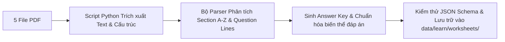

# Kế hoạch Triển khai: Hệ thống Bài tập Ngữ pháp Trực tuyến (Grammar Worksheets Web)

> **Tài liệu nguồn**: 5 file PDF trích xuất từ 60 bài học tổng hợp (175 trang, 365 phần bài tập) lưu tại `docs/worksheets_split/`.  
> **Mục tiêu**: Số hóa toàn bộ 60 bài tập thành các bài luyện tập tương tác trực tiếp trên nền tảng web WeWIN IELTS, đảm bảo câu hỏi, bối cảnh và đáp án trung thực với tài liệu gốc, hỗ trợ chấm điểm tức thì và lưu trữ tiến độ học viên.

---

## 1. Tổng quan & Mục tiêu Dự án

### 1.1. Hiện trạng
- Nền tảng WeWIN hiện có sẵn chuyên mục Ngữ pháp tại `/learn/vocab-grammar/grammar` với **200 chủ đề ngữ pháp**, tuy nhiên phần lớn các chủ đề này hiện chưa có bài tập thực hành (`exercises: []`).
- Bộ tài liệu `docs/worksheets_split/` gồm 5 tập PDF (WS 01 – WS 60) chứa hệ thống bài tập thực hành phong phú, từ trình độ nền tảng (A1/A2) đến nâng cao (B1/B2/IELTS Foundation), bao quát toàn bộ các cấu trúc ngữ pháp trọng yếu trong tiếng Anh.

### 1.2. Mục tiêu triển khai
1. **Số hóa 100%**: Chuyển đổi toàn bộ 60 bài Worksheet và 365 phần bài tập sang định dạng dữ liệu có cấu trúc (JSON Schema).
2. **Giao diện làm bài tương tác (Interactive Web UI)**: Cung cấp giao diện làm bài hiện đại, mượt mà, phản hồi ngay lập tức (Instant feedback) trên cả Desktop và Mobile.
3. **Thuật toán chấm điểm thông minh**: Chấm điểm tự động, linh hoạt với chữ hoa/thường, dạng viết tắt (*I'm / I am*, *don't / do not*), dấu câu, chấp nhận nhiều phương án đúng tương đương.
4. **Đồng bộ 2 chiều**:
   - Vừa hoạt động như **Thư viện Worksheet độc lập** (Worksheets Hub: 60 bài tuần tự từ cơ bản đến nâng cao).
   - Vừa liên kết trực tiếp vào các bài học lý thuyết tương ứng trong mục **Ngữ pháp WeWIN** (`/learn/vocab-grammar/grammar`).

---

## 2. Bảng ánh xạ Dạng bài tập (PDF $\rightarrow$ Web Component)

Qua phân tích 5 file PDF, các bài tập được phân loại thành **10 dạng câu hỏi tương tác chính** trên Web:

| STT | Dạng bài trong PDF | Tần suất | UI Component trên Web | Mô tả tương tác học viên |
| :--- | :--- | :--- | :--- | :--- |
| **1** | **Điền khuyết đơn câu (Sentence Gap-fill)** | Rất cao (~120 bài) | `<InlineGapFill />` | Các ô input nhỏ nằm thẳng hàng trong câu (inline text). Học viên gõ đại từ, to be, giới từ, mạo từ... |
| **2** | **Điền đoạn văn / Thư có Word Bank** | Trung bình (~25 bài) | `<PassageGapFill withWordBank />` | Khung từ gợi ý ở trên (Word Bank). Khi học viên gõ/chọn từ, từ đó sẽ bị gạch mờ trong khung. |
| **3** | **Chia động từ theo thì (Verb Conjugation)** | Rất cao (~90 bài) | `<VerbFormExercise />` | Động từ nguyên mẫu nằm trong ngoặc `(play)`. Ô input tự động kiểm tra dạng đúng theo thì được yêu cầu. |
| **4** | **Viết lại câu (Sentence Transformation / Rewrite)** | Cao (~50 bài) | `<SentenceRewrite />` | Ô gõ nguyên câu hoặc phần nối tiếp của câu gợi ý. Chấm điểm dung sai chuỗi linh hoạt. |
| **5** | **Trắc nghiệm / Chọn từ (Multiple Choice & Binary Selection)** | Trung bình (~35 bài) | `<ChoiceSelector />` | Nút chọn trắc nghiệm A/B/C/D hoặc các thẻ chọn giữa 2 phương án (ví dụ: `was` / `were`, `some` / `any`, `-ed` / `-ing`). |
| **6** | **Nối câu / Ghép mệnh đề (Sentence Combining)** | Trung bình (~20 bài) | `<SentenceCombine />` | Nối 2 câu đơn thành câu phức (với Đại từ quan hệ, liên từ nhượng bộ, nguyên nhân...). |
| **7** | **Đặt câu hỏi cho từ gạch chân (Ask Questions)** | Trung bình (~15 bài) | `<QuestionFormation />` | Hiển thị câu gốc với phần gạch chân nổi bật, học viên nhập câu hỏi Wh- tương ứng. |
| **8** | **Sửa lỗi sai & True/False (Error Correction)** | Trung bình (~15 bài) | `<ErrorCorrection />` | Click vào vị trí từ sai trong câu hoặc đoạn thư để nhập từ sửa đúng; chọn T/F và sửa câu sai. |
| **9** | **Xây dựng câu / Sắp xếp từ (Word Order / Prompts)** | Thấp (~10 bài) | `<SentenceScramble />` | Gợi ý từ cách nhau bằng dấu gạch chéo `/` hoặc các thẻ từ xáo trộn để kéo thả/gõ câu hoàn chỉnh. |
| **10** | **Đọc hiểu & Trả lời câu hỏi (Reading Q&A)** | Trung bình (~15 bài) | `<SplitReadingWorkspace />` | Giao diện chia đôi: Bên trái hiển thị bài đọc / bưu thiếp / bảng thông tin; Bên phải là câu hỏi trả lời. |

---

## 3. Kiến trúc Dữ liệu (Data Architecture & Schema)

### 3.1. Vị trí lưu trữ dữ liệu
- Thư mục dữ liệu: `data/learn/worksheets/`
- Tệp định danh danh mục: `data/learn/worksheets-catalog.json` (quản lý metadata của 60 bài).
- Tệp chi tiết từng bài: `data/learn/worksheets/ws-01.json` $\rightarrow$ `data/learn/worksheets/ws-60.json`.

### 3.2. TypeScript Interface chuẩn hóa

```typescript
// Định nghĩa loại câu hỏi tương tác
export type WorksheetQuestionType =
  | "inline_gap_fill"       // Điền từ vào câu
  | "passage_gap_fill"      // Điền đoạn văn/bức thư có ngân hàng từ
  | "verb_conjugation"      // Chia động từ trong ngoặc
  | "sentence_rewrite"      // Viết lại câu không đổi nghĩa
  | "multiple_choice"       // Trắc nghiệm A/B/C/D hoặc chọn từ trong ngoặc
  | "sentence_combine"      // Nối câu dùng liên từ hoặc đại từ quan hệ
  | "question_formation"    // Đặt câu hỏi cho phần gạch chân
  | "error_correction"      // Sửa lỗi sai trong câu hoặc đoạn văn
  | "sentence_building"     // Xây dựng câu từ từ gợi ý (/)
  | "matching"              // Ghép cặp hai cột A - B
  | "reading_qa";           // Đọc đoạn văn/bảng biểu và trả lời câu hỏi

export interface WorksheetQuestion {
  id: string;                      // ws01-a-q01
  order: number;
  prompt: string;                  // Nội dung câu hỏi (hỗ trợ placeholder [gap] hoặc gạch chân)
  underlinedPart?: string;         // Phần gạch chân (nếu là dạng đặt câu hỏi)
  verbBase?: string;               // Động từ nguyên thể (nếu là dạng chia thì: e.g. "go")
  options?: string[];              // Các lựa chọn (nếu là trắc nghiệm)
  acceptedAnswers: string[];       // Danh sách tất cả các đáp án đúng được chấp nhận
  explanation?: string;            // Giải thích ngữ pháp ngắn gọn
  sampleAnswer?: string;           // Câu mẫu minh họa
}

export interface WorksheetSection {
  id: string;                      // ws01-sec-a
  sectionKey: string;              // "A", "B", "C"...
  instruction: string;             // Hướng dẫn bài tập (e.g. "Fill in the blanks using HE, SHE...")
  type: WorksheetQuestionType;
  contextText?: string;            // Đoạn văn đọc hiểu, bức thư hoặc bài hội thoại chung
  tableData?: {                    // Bảng biểu dữ liệu (nếu có, e.g. thời khóa biểu, info khách sạn)
    headers: string[];
    rows: string[][];
  };
  wordBank?: string[];             // Danh sách từ gợi ý cho sẵn (nếu có)
  questions: WorksheetQuestion[];
}

export interface WorksheetLesson {
  id: string;                      // ws-01
  order: number;                   // 1 -> 60
  part: 1 | 2 | 3 | 4 | 5;         // Thuộc Part nào trong 5 tập
  slug: string;                    // "ws-01-subject-pronouns-to-be"
  title: string;                   // "WORKSHEET 1"
  subject: string;                 // "Subject Pronouns and Verb 'To Be'"
  subjectVi: string;               // "Đại từ nhân xưng và Động từ To Be"
  level: "A1" | "A2" | "B1" | "B2";
  pageRange: string;               // "Trang 001 - 004"
  linkedGrammarTopics?: string[];  // Liên kết với slug bên vocab-grammar (e.g. ["g1-english-tenses"])
  sections: WorksheetSection[];
}
```

---

## 4. Pipeline Số hóa & Trích xuất Dữ liệu (PDF $\rightarrow$ JSON)

Để chuyển đổi 175 trang tài liệu một cách chuẩn xác và tiết kiệm thời gian, quy trình thực hiện gồm 4 bước:



### Chi tiết các bước thực hiện:
1. **Bước 1: Trích xuất Text & Tách bài học (Extraction)**
   - Sử dụng thư viện `pdftotext` và script Python quét theo tiêu đề `WORKSHEET X` và `SUBJECT : ...`.
   - Lưu trữ các tệp thô tạm thời để xử lý.
2. **Bước 2: Phân tích cú pháp từng Section (Section Parsing)**
   - Nhận diện các Section bằng ký hiệu `A)`, `B)`, `C)`...
   - Tách dòng chỉ dẫn bài tập (`Instruction`).
   - Phân loại tự động `type` của Section dựa trên từ khóa nhận diện:
     - Chứa *“Fill in the blanks”*, *“Complete with”* $\rightarrow$ `inline_gap_fill` / `passage_gap_fill`.
     - Chứa *“Put the verbs in brackets”*, *“Supply tense”* $\rightarrow$ `verb_conjugation`.
     - Chứa *“Rewrite the sentences”*, *“Change into”* $\rightarrow$ `sentence_rewrite`.
     - Chứa *“Circle”*, *“Choose”* $\rightarrow$ `multiple_choice`.
     - Chứa *“Ask questions for the underlined”* $\rightarrow$ `question_formation`.
     - Chứa *“Read the passage and answer”* $\rightarrow$ `reading_qa`.
3. **Bước 3: Tạo Bộ Đáp án Chuẩn (Answer Key Generation)**
   - Sinh bộ đáp án đối chiếu dựa trên quy tắc ngữ pháp tương ứng của từng chuyên đề.
   - Bổ sung các phương án viết tắt phổ biến:
     - Ví dụ: `["I'm", "I am"]`, `["don't", "do not"]`, `["didn't visit", "did not visit"]`.
4. **Bước 4: Kiểm tra tính hợp lệ (Validation)**
   - Chạy script kiểm tra cú pháp JSON, kiểm tra 100% các câu hỏi đều có ít nhất 1 đáp án trong `acceptedAnswers`.

---

## 5. Thiết kế Giao diện Người dùng (UI/UX) trên Web

### 5.1. Trang Danh mục Worksheet (`/learn/worksheets`)
- **Bộ lọc thông minh**:
  - Lọc theo **5 Part** (Tương ứng với 5 file PDF).
  - Lọc theo **Cấp độ** (A1, A2, B1, B2).
  - Lọc theo **Chủ điểm ngữ pháp** (Thì, Bị động, Gián tiếp, Mệnh đề quan hệ, Động từ khuyết thiếu...).
- **Thẻ hiển thị bài học (Worksheet Card)**:
  - Tên bài: *Worksheet 01 – Subject Pronouns & To Be*.
  - Huy hiệu cấp độ, số lượng phần bài tập (e.g. *14 bài tập con - 120 câu hỏi*).
  - Trạng thái hoàn thành: *Chưa làm*, *Đang làm dở (50%)*, *Đã hoàn thành (95/100 điểm)*.

### 5.2. Giao diện Màn hình Làm bài (`/learn/worksheets/[slug]`)
- **Thanh điều hướng trên cùng (Sticky Header)**:
  - Nút quay lại danh mục, tiêu đề Worksheet.
  - Bộ đếm tiến độ: số câu đã làm / tổng số câu (Progress Bar).
  - Nút chuyển nhanh giữa các Section (A, B, C, D...).
- **Khu vực hiển thị câu hỏi (Card-based Layout)**:
  - Mỗi Section được đặt trong một Card riêng biệt, hiển thị rõ dòng lệnh hướng dẫn in đậm.
  - Nếu có Word Bank: Hiển thị các Badge từ gợi ý phía trên.
  - Nếu có bài đọc / bảng dữ liệu: Hiển thị khung văn bản / bảng trực quan có thanh cuộn độc lập.
- **Khu vực Thao tác (Action Footer)**:
  - Nút **Kiểm tra đáp án (Check Answers)** cho từng Section hoặc toàn bài.
  - Nút **Làm lại (Reset)**.
  - Nút **Xem lời giải chi tiết (Show Explanations)** (chỉ mở sau khi đã nộp bài).

### 5.3. Thuật toán Chấm điểm Thông minh (Grading Engine)
Để tránh trải nghiệm ức chế cho học viên khi gõ đúng ngữ pháp nhưng khác biệt về dấu cách hay viết hoa, hệ thống áp dụng cơ chế chuẩn hóa chuỗi mềm dẻo:
1. **Trim & Normalize Whitespace**: Loại bỏ khoảng trắng thừa ở đầu/cuối và giữa các từ.
2. **Case Insensitive**: Không phân biệt chữ hoa/thường (trừ các đại từ riêng đặc thù như *I*).
3. **Punctuation Stripping**: Bỏ qua dấu chấm `.`, dấu phẩy `,` hoặc dấu chấm hỏi `?` ở cuối câu khi so sánh câu viết lại.
4. **Contraction Normalization**: Đồng nhất các dạng viết tắt phổ biến:
   - `he's` $\leftrightarrow$ `he is`
   - `she isn't` $\leftrightarrow$ `she is not`
   - `they didn't` $\leftrightarrow$ `they did not`
   - `I've` $\leftrightarrow$ `I have`
   - `won't` $\leftrightarrow$ `will not`
5. **Dấu nháy đơn**: Chấp nhận cả `'` (ASCII 39) lẫn `’` (Unicode right single quotation mark).

---

## 6. Lộ trình Triển khai (Phases & Milestones)

```
[Phase 1: Chuẩn hóa & Script Parser]
   ├── Tạo cấu trúc thư mục data/learn/worksheets/
   ├── Viết script parse tự động 60 file JSON
   └── Tạo mẫu chuẩn hóa ws-01.json -> ws-10.json (Part 1)
          │
[Phase 2: Xây dựng UI Components]
   ├── Component Gap-fill (Inline & Boxed)
   ├── Component Sentence Rewrite & Verb Conjugation
   ├── Component Multiple Choice & Question Formation
   └── Grading Engine (Thuật toán so khớp đáp án mềm dẻo)
          │
[Phase 3: Xây dựng Routes & Giao diện Trang]
   ├── Trang Hub: /learn/worksheets (danh sách 60 bài)
   ├── Trang Player: /learn/worksheets/[slug]
   └── Cơ chế lưu tiến độ học tập vào LocalStorage / Database
          │
[Phase 4: Nhập liệu toàn diện & QA]
   ├── Import hoàn chỉnh Part 2, Part 3, Part 4, Part 5
   ├── Kiểm thử độ chính xác của Answer Key
   └── Liên kết ngược vào các bài học tại /learn/vocab-grammar/grammar
```

---

## 7. Phân bổ 60 Bài học theo Chủ điểm Ngữ pháp WeWIN

| Tập file | Danh sách Worksheet | Chủ điểm ngữ pháp | Khóa liên kết trong WeWIN |
| :--- | :--- | :--- | :--- |
| **Part 1** | WS 01 $\rightarrow$ WS 10 | To Be, Hiện tại đơn, Tiếp diễn, Quá khứ đơn, Quá khứ tiếp diễn, Hiện tại hoàn thành | `g1-english-tenses` |
| **Part 2** | WS 11 $\rightarrow$ WS 20 | HTHT tiếp diễn, Quá khứ hoàn thành, Tương lai, Ôn tập tổng hợp thì | `g1-english-tenses` |
| **Part 2 - 3**| WS 21 $\rightarrow$ WS 25 | Câu bị động (Passive Voice cơ bản đến nâng cao) | `g3-passive-voice` |
| **Part 3** | WS 26 $\rightarrow$ WS 27 | Câu gián tiếp / Tường thuật (Reported Speech) | `g10-reported-speech` |
| **Part 3** | WS 28 $\rightarrow$ WS 29 | Tính từ & Trạng từ, Tính từ đuôi -ed / -ing | `g8-1-adjectives` |
| **Part 3** | WS 30 $\rightarrow$ WS 32 | Câu điều kiện (1, 2, 3), Câu ước (Wishes / If only) | `g9-conditionals` |
| **Part 3** | WS 33 | So sánh hơn và So sánh nhất (Comparatives & Superlatives) | `g8-2-comparatives` |
| **Part 3** | WS 34 $\rightarrow$ WS 35 | Giới từ thời gian, nơi chốn (at, in, on, by...) | `g5-prepositions` |
| **Part 3 - 4**| WS 36 $\rightarrow$ WS 37 | Mệnh đề quan hệ (Relative Clauses) | `g4-relative-clauses` |
| **Part 4** | WS 38 $\rightarrow$ WS 40 | Modals, Used to / Would / Be used to | `g7-2-modal-verbs` |
| **Part 4** | WS 41 $\rightarrow$ WS 42 | Lượng từ, Đại từ bất định (some, any, much, many...) | `g6-1-nouns-quantity` |
| **Part 4** | WS 43 | Câu hỏi đuôi (Tag questions) | `g11-tag-questions` |
| **Part 4** | WS 44 | Thể sai khiến (Causatives: have/get sth done) | `g3-passive-voice` |
| **Part 4** | WS 45 | Liên từ kép (Both...and, Either...or, Neither...nor...) | `g12-conjunctions` |
| **Part 4** | WS 46 | Mạo từ (A, An, The) | `g6-2-articles` |
| **Part 4** | WS 47 $\rightarrow$ WS 49 | Mệnh đề mục đích, nguyên nhân, kết quả, tương phản | `g13-clauses-connectors` |
| **Part 4** | WS 50 $\rightarrow$ WS 51 | Danh động từ & Động từ nguyên mẫu (Gerund or Infinitive) | `g7-1-verb-patterns` |
| **Part 5** | WS 52 $\rightarrow$ WS 54 | Đại từ sở hữu & Phản thân (Possessive & Reflexive Pronouns) | `g2-subject-verb-agreement` |
| **Part 5** | WS 55 $\rightarrow$ WS 56 | Động từ khuyết thiếu quá khứ (Perfect Modals) | `g7-2-modal-verbs` |
| **Part 5** | WS 57 $\rightarrow$ WS 59 | Sở hữu cách, So do I / Neither do I, Too / Enough | `g14-structures` |
| **Part 5** | WS 60 | **Bài kiểm tra Viết lại câu tổng hợp (Master Rewrite)** | Đánh giá tổng hợp cuối khóa |

